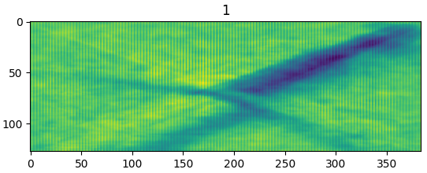
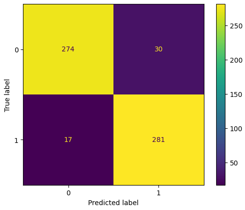
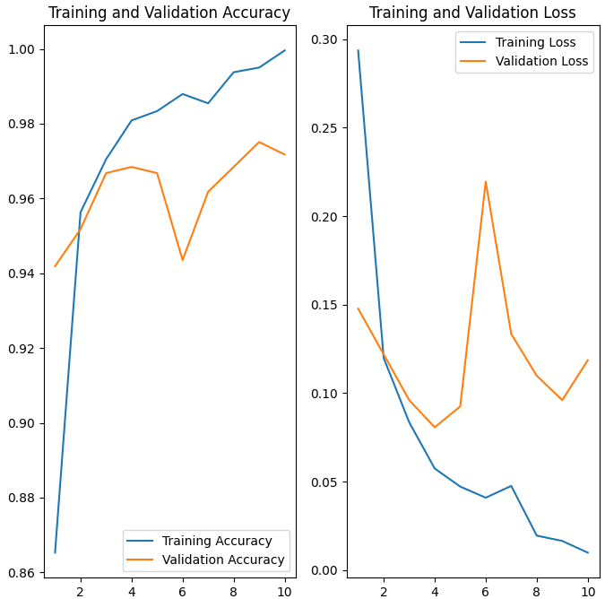

# Machine Learning for Image Classification

A machine learning project exploring image classification using feature extraction, dimensionality reduction, traditional machine learning algorithms and deep learning.

The project investigates different approaches to image recognition, comparing learned representations from convolutional neural networks, transfer learning and Vision Transformers.

## Overview

Image classification involves assigning images to predefined categories based on their visual content. This project explores how different feature representations and machine learning architectures affect classification performance.

The project covers:

- Image dataset exploration and preprocessing.
- Feature extraction using Histogram of Oriented Gradients (HOG).
- Dimensionality reduction using Principal Component Analysis (PCA).
- Traditional machine learning classifiers.
- Convolutional Neural Networks (CNNs).
- Transfer learning using MobileNetV2.
- Vision Transformers (ViT).
- Model evaluation and performance comparison.

**Project status:** University project / experimental research.

## Screenshots








## Dataset

The project uses an image dataset for supervised classification experiments.

Images are processed into suitable representations for traditional machine learning and deep learning approaches.

Dataset details:

- **Task:** Image classification.
- **Input:** Digital images.
- **Features:** HOG descriptors and learned image representations.
- **Dimensionality reduction:** PCA, where applicable.
- **Target:** Image class labels.
- **Dataset source:** Sushi and Swords from Voxel51 https://docs.voxel51.com/user_guide/using_datasets.html

## Feature Engineering

The project explores different approaches to representing images for classification.

- **Histogram of Oriented Gradients (HOG):** Represents local image structure using gradient orientations.
- **Principal Component Analysis (PCA):** Reduces feature dimensionality while retaining as much variance as possible.
- **Image preprocessing:** Prepares images for consistent feature extraction and model input.
- **Learned representations:** Deep learning models learn visual features directly from images.

These approaches allow comparisons between manually engineered features and representations learned during training.

## Models

The experiments explore traditional machine learning algorithms and deep learning architectures.

| Model family | Models |
|---|---|
| Traditional machine learning | K-Nearest Neighbours (KNN), Decision Tree, Random Forest, SGD classifier |
| Neural networks | Multilayer Perceptron (MLP), Convolutional Neural Network (CNN) |
| Transfer learning | MobileNetV2 |
| Transformer-based models | Vision Transformer (ViT) |

## Methodology

The general workflow consists of:

1. Loading and exploring the image dataset.
2. Inspecting class distributions and image characteristics.
3. Preprocessing images into a consistent format.
4. Extracting HOG features and applying PCA where appropriate.
5. Training traditional machine learning classifiers.
6. Training or fine-tuning deep learning models.
7. Evaluating predictions on held-out test data.
8. Comparing performance and analysing misclassified examples.

## Evaluation

Model performance should be assessed using appropriate classification metrics.

Possible metrics include:

- **Accuracy:** Proportion of correctly classified images.
- **Precision:** Proportion of positive predictions that are correct.
- **Recall:** Proportion of actual positive examples correctly identified.
- **F1-score:** Harmonic mean of precision and recall.
- **Confusion matrix:** Breakdown of correct and incorrect predictions by class.

## Installation

Clone the repository:

```bash
git clone https://github.com/zagyarakushi/machine-learning-image-classification.git
cd machine-learning-image-classification
```

## Usage

Explore the project notebooks to inspect the dataset, run preprocessing and feature extraction, train models and evaluate classification performance.

Refer to the notebooks for the implemented experiments and their specific execution requirements.

## Limitations

- Classification performance depends on dataset size, quality, class balance and diversity.
- Models may perform differently on images outside the training distribution.
- Results can be affected by preprocessing, feature selection and hyperparameter tuning.
- Comparisons depend on consistent data splits and evaluation procedures.
- Transfer learning results depend on the pretrained weights and fine-tuning configuration.
- Computational requirements vary between traditional classifiers, CNNs and Vision Transformers.

## Future Improvements

Potential extensions include:

- Systematic hyperparameter optimisation.
- Class-wise performance and error analysis.
- Experiments with data augmentation.
- Evaluation on additional datasets.
- Comparison of inference speed and model size.
- Reproducible experiments using fixed random seeds.

## Technologies

- Python
- NumPy
- pandas
- scikit-learn
- TensorFlow / Keras
- Matplotlib
- Seaborn
- Jupyter Notebook

## Disclaimer

This repository documents educational machine learning experiments. Results should be interpreted in the context of the dataset, experimental setup and evaluation methodology.

## Author

**Charles Buckley**

- GitHub: https://github.com/zagyarakushi
- GitLab: https://gitlab.com/zagyarakushi